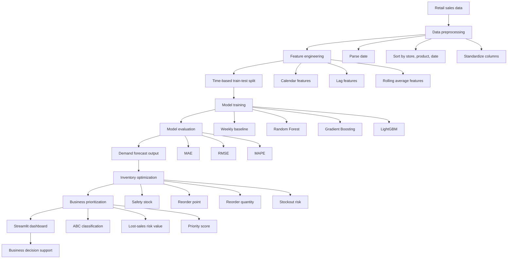
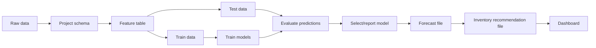
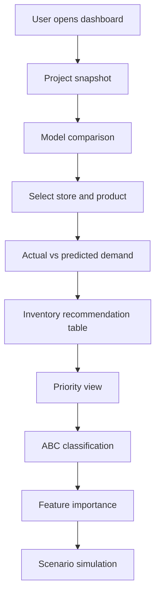

# AI Demand Forecasting and Inventory Optimization Dashboard

This project is an end-to-end supply-chain analytics project. It forecasts store-product level demand and converts the forecast into inventory planning decisions such as safety stock, reorder point, reorder quantity, stockout risk, and SKU priority.

The goal is not only to build a machine learning model. The goal is to show how ML output can support a real business decision.

## Quick Summary

| Item | Description |
| --- | --- |
| Business problem | Predict product demand and reduce stockout/overstock risk |
| ML task | Supervised regression |
| Target variable | `units_sold` |
| Validation method | Time-based train-test split |
| Forecast horizon | Latest 14 days |
| Baseline | Previous week's demand for the same store-product |
| Primary model | Random Forest |
| Compared models | Weekly Baseline, Random Forest, Gradient Boosting, LightGBM |
| Main metrics | MAE, RMSE, MAPE |
| Dashboard | Streamlit + Plotly |
| Current data status | Demo/test dataset included; real Kaggle adapter available |

Important: the checked-in metrics are from generated demo/test data. They prove that the pipeline works, but they should not be presented as real-world performance. For resume submission, download a real Kaggle dataset and re-run the pipeline.

## Business Problem

Retail, FMCG, and supply-chain teams need to answer:

```text
How much stock should each store keep for each product?
```

Two common problems occur:

- **Stockout**: demand exists, but the product is unavailable.
- **Overstocking**: too much stock is held, increasing storage cost and blocked capital.

This project solves the problem in two stages:

1. Forecast future demand.
2. Convert the forecast into inventory actions.

## Methodology Flowchart



## End-To-End Project Flow



## Dataset Status

This repository currently includes a generated demo/test dataset:

[data/sample_retail_demand.csv](/Users/d/demand-forecasting-inventory-optimizer/data/sample_retail_demand.csv)

It is used to verify:

- Code execution
- Feature engineering
- Model training
- Inventory formulas
- Dashboard behavior
- Unit tests

For a final resume/GitHub submission, use a real dataset and update the metrics.

Recommended real dataset:

**Kaggle Store Item Demand Forecasting**

Expected raw columns:

| Raw column | Meaning |
| --- | --- |
| `date` | Sales date |
| `store` | Store ID |
| `item` | Product/item ID |
| `sales` | Units sold |

The adapter converts it into the project schema:

| Project column | Meaning |
| --- | --- |
| `date` | Sales date |
| `store_id` | Store identifier |
| `product_id` | Product identifier |
| `category` | Product category, if available |
| `units_sold` | Demand target |
| `price` | Optional business feature |
| `promotion` | Optional business feature |
| `holiday` | Optional business feature |
| `competitor_price` | Optional business feature |
| `inventory_on_hand` | Used only after forecasting for inventory logic |

Because the Kaggle Store Item dataset does not include price, promotion, competitor price, or actual inventory, those columns are set to neutral/default values during conversion. Demand forecasting still uses real sales data. Inventory recommendations become planning estimates unless actual inventory data is supplied.

## Data Preprocessing

The preprocessing pipeline prepares the data for time-series supervised learning.

Steps:

1. Parse the `date` column into datetime format.
2. Sort data by `store_id`, `product_id`, and `date`.
3. Ensure required columns are available.
4. Create calendar-based features.
5. Create lag features from past demand.
6. Create rolling average features from past demand.
7. Drop rows where lag/rolling values are unavailable.
8. Split data using time-based validation.

## Feature Engineering

The model predicts:

```text
units_sold
```

Feature groups:

| Feature group | Examples | Why it matters |
| --- | --- | --- |
| Calendar features | `day_of_week`, `month`, `is_weekend`, `day_of_year` | Demand changes by day, weekend, and season |
| Lag features | `lag_1`, `lag_7`, `lag_14`, `lag_28` | Recent past demand helps forecast future demand |
| Rolling averages | `rolling_mean_7`, `rolling_mean_14`, `rolling_mean_28` | Smooths daily noise and captures trend |
| Optional business drivers | `price`, `promotion`, `holiday`, `competitor_price` | Useful when the dataset includes these fields |

Important leakage prevention:

```text
rolling averages use shift(1)
```

This means today's demand is not used to predict today. The model only sees past information.

## Train-Test Split

This project uses a **time-based train-test split**, not a random split.

Why?

Demand forecasting is a future prediction problem. In the real world, the model is trained on past sales and used to predict future demand.

Current split logic:

```text
Training data = earlier dates
Testing data = latest 14 days
```

Code logic:

```python
cutoff_date = data["date"].max() - pd.Timedelta(days=horizon_days)
train = data[data["date"] <= cutoff_date]
test = data[data["date"] > cutoff_date]
```

Current demo split:

| Split | Rows |
| --- | ---: |
| Training data | 27,520 |
| Testing data | 560 |
| Forecast horizon | 14 days |

## ML Models Used

This project compares four approaches:

| Model | Purpose |
| --- | --- |
| Weekly Baseline | Simple business benchmark |
| Random Forest | Primary explainable ML model |
| Gradient Boosting | Stronger boosted tree comparison |
| LightGBM | Efficient gradient boosting model |

### Why Random Forest?

Random Forest is used as the primary model because:

- It handles non-linear demand patterns.
- It works well with lag and rolling features.
- It requires limited tuning.
- It provides feature importance.
- It is easier to explain in interviews than complex deep learning models.

### Why LightGBM?

LightGBM is added for comparison because boosted tree models often perform strongly on tabular forecasting features. It helps show that the project compares models instead of relying on a single algorithm.

## Baseline

The baseline is:

```text
Prediction = demand from the same store-product 7 days earlier
```

This is also called a weekly seasonal naive baseline.

Example:

```text
If Product A in Store 1 sold 50 units last Monday,
baseline predicts 50 units for this Monday.
```

The ML model should beat this baseline to prove that it adds value.

## Evaluation Metrics

| Metric | Meaning | Why used |
| --- | --- | --- |
| MAE | Average absolute error in units | Easy to understand operationally |
| RMSE | Penalizes large errors more than MAE | Useful when big misses are costly |
| MAPE | Average percentage error | Helps compare relative error across products |

MAPE limitation:

MAPE can be misleading for low-demand products because percentage error becomes unstable when actual demand is small.

## Latest Demo Results

Latest verified run: **2026-10-07**

These numbers are from generated demo/test data only.

### Dataset Used In Current Run

| Detail | Value |
| --- | ---: |
| Dataset source | Generated demo retail demand dataset |
| Dataset file | `data/sample_retail_demand.csv` |
| Total rows | 29,200 |
| Stores | 5 |
| SKUs/products | 8 |
| Store-SKU combinations | 40 |
| Date range | 2024-10-08 to 2026-10-07 |
| Product categories | 4 |

Categories:

```text
Beverages, Home Care, Personal Care, Snacks
```

### Train-Test Split In Current Run

| Split detail | Value |
| --- | ---: |
| Split type | Time-based |
| Training rows | 27,520 |
| Testing rows | 560 |
| Forecast horizon | Latest 14 days |

The model is trained on earlier dates and tested on the latest 14 days. This simulates the real forecasting setup where only past sales data is available while predicting future demand.

| Metric | Value |
| --- | ---: |
| Dataset | Demo/generated retail data |
| Primary model | Random Forest |
| Training rows | 27,520 |
| Test rows | 560 |
| Forecast horizon | 14 days |
| MAE | 4.964 units |
| RMSE | 6.642 units |
| MAPE | 6.080% |
| Baseline MAE | 11.264 units |
| MAE improvement vs baseline | 55.931% |

The primary saved model is Random Forest because it is explainable and provides feature importance. In the current demo comparison, LightGBM achieved the best numerical performance.

## Demo Model Comparison

| Model | MAE | RMSE | MAPE | MAE Improvement vs Baseline |
| --- | ---: | ---: | ---: | ---: |
| Weekly baseline | 11.264 | 16.713 | 13.040% | 0.000% |
| Random Forest | 4.964 | 6.642 | 6.080% | 55.931% |
| Gradient Boosting (sklearn) | 4.850 | 6.363 | 5.976% | 56.945% |
| LightGBM | 4.791 | 6.327 | 5.923% | 57.468% |

On real data, expect weaker but more credible results. A realistic result is better than a suspiciously perfect one.

### Best Model In Current Demo Run

| Detail | Value |
| --- | ---: |
| Best numerical model | LightGBM |
| MAE | 4.791 |
| RMSE | 6.327 |
| MAPE | 5.923% |
| MAE improvement vs weekly baseline | 57.468% |

Simple interpretation:

```text
Weekly baseline average error = 11.264 units
LightGBM average error = 4.791 units
```

So, on the demo dataset, LightGBM reduced the average forecast error by 57.468% compared to the weekly baseline.

## Inventory Optimization

After demand is forecasted, the project converts ML predictions into inventory decisions.

Inventory outputs:

| Output | Meaning |
| --- | --- |
| Average daily forecast | Expected daily demand |
| Lead-time demand | Demand expected during supplier lead time |
| Safety stock | Extra stock for uncertainty |
| Reorder point | Inventory level where replenishment should be triggered |
| Reorder quantity | Suggested quantity to order |
| Stockout risk | High, Medium, or Low risk label |

Safety stock formula:

```text
safety_stock = z * demand_std * sqrt(lead_time)
```

Reorder point formula:

```text
reorder_point = lead_time_demand + safety_stock
```

Current assumptions:

| Parameter | Value |
| --- | ---: |
| Lead time | 7 days |
| Service level z-score | 1.65 |
| Approximate service level | 95% |

## ABC-Based SKU Prioritization

ABC classification is used to prioritize products by revenue contribution.

| Class | Meaning |
| --- | --- |
| A | Highest revenue contribution, highest attention |
| B | Medium revenue contribution |
| C | Lower revenue contribution, long-tail items |

Why it matters:

If two products have stockout risk, the high-revenue A-class product should usually be handled first.

This project combines:

```text
ABC class + stockout risk + lost-sales risk value
```

to create a business priority score.

### ABC Results In Current Demo Run

| ABC Class | Number of SKUs | Meaning |
| --- | ---: | --- |
| A | 4 | Highest revenue contribution |
| B | 2 | Medium revenue contribution |
| C | 2 | Lower revenue contribution |

Detailed SKU classification:

| Product | Category | Revenue Share | Cumulative Revenue Share | ABC Class |
| --- | --- | ---: | ---: | --- |
| P008 | Home Care | 18.8% | 18.8% | A |
| P006 | Personal Care | 17.3% | 36.1% | A |
| P007 | Home Care | 17.1% | 53.2% | A |
| P005 | Personal Care | 15.4% | 68.6% | A |
| P001 | Beverages | 11.2% | 79.8% | B |
| P003 | Snacks | 8.6% | 88.4% | B |
| P002 | Beverages | 6.3% | 94.6% | C |
| P004 | Snacks | 5.4% | 100.0% | C |

### Stockout Risk Results In Current Demo Run

The project generated inventory recommendations for all 40 store-SKU combinations.

| Stockout Risk | Count |
| --- | ---: |
| High | 40 |
| Medium | 0 |
| Low | 0 |

High-risk combinations by ABC class:

| ABC Class | High-Risk Store-SKU Count |
| --- | ---: |
| A | 20 |
| B | 10 |
| C | 10 |

Total recommended reorder quantity:

```text
18,048.13 units
```

Important: because this is the generated demo dataset, the stockout risk distribution should be treated as a demonstration of the logic, not a real business conclusion. After running on real data with actual inventory values, this section should be updated with real inventory-risk numbers.

## Dashboard Explanation

The Streamlit dashboard is designed so a recruiter or interviewer can understand the project without reading the code.

Dashboard sections:

| Section | What it explains |
| --- | --- |
| Project snapshot | Dataset, validation method, primary model, inventory source |
| KPI cards | MAE, RMSE, MAPE, baseline improvement |
| Model comparison | Baseline vs Random Forest vs Gradient Boosting vs LightGBM |
| Actual vs predicted | Forecast quality for selected store-product |
| Preprocessing design | How leakage is avoided and how the split is done |
| Inventory recommendations | Reorder quantity, reorder point, safety stock, stockout risk |
| Priority view | Most urgent store-product actions |
| ABC classification | High/medium/low revenue product groups |
| Forecast drivers | Feature importance |
| Scenario simulator | Simple price/promotion what-if analysis |

## Dashboard Flowchart



## Design Decisions For Interviews

| Question | Answer |
| --- | --- |
| Why Random Forest? | Handles non-linear effects, works well with tabular lag features, robust with little tuning, and gives feature importance. |
| Why LightGBM? | Provides a strong boosted-tree comparison model for tabular data. |
| How is data split? | Time-based split: train on earlier dates, test on the latest 14 days. |
| How is leakage avoided? | Lag and rolling features use past demand only; rolling means use `shift(1)`. |
| Is inventory used as an ML feature? | No. It is used after forecasting for reorder calculations. |
| What is the baseline? | Same store-product demand from 7 days earlier. |
| Why MAE and MAPE? | MAE is interpretable in units; MAPE gives relative error but can be unstable for low-demand items. |
| How is ABC done? | Products are ranked by revenue contribution and grouped into A, B, and C classes. |

## Project Structure

```text
demand-forecasting-inventory-optimizer/
├── .gitignore
├── README.md
├── requirements.txt
├── data/
│   ├── sample_retail_demand.csv
│   └── retail_demand_real.csv
├── docs/
│   ├── dataset_strategy.md
│   ├── project_report.md
│   └── resume_and_interview_notes.md
├── outputs/
│   ├── demand_forecast.csv
│   ├── feature_importance.csv
│   ├── inventory_recommendations.csv
│   ├── model_comparison.csv
│   ├── metrics.json
│   ├── model.joblib
│   └── sku_abc_analysis.csv
├── src/
│   ├── __init__.py
│   ├── app.py
│   ├── business_analysis.py
│   ├── config.py
│   ├── features.py
│   ├── generate_sample_data.py
│   ├── inventory.py
│   ├── prepare_real_data.py
│   └── train_model.py
└── tests/
    └── test_inventory.py
```

## Key Files

| File | Purpose |
| --- | --- |
| `src/generate_sample_data.py` | Creates demo/test retail data |
| `src/prepare_real_data.py` | Converts Kaggle Store Item data into project schema |
| `src/features.py` | Creates calendar, lag, and rolling features |
| `src/train_model.py` | Trains models, evaluates metrics, writes outputs |
| `src/inventory.py` | Calculates safety stock, reorder point, reorder quantity, risk |
| `src/business_analysis.py` | Builds ABC classification and priority score |
| `src/app.py` | Streamlit dashboard |
| `tests/test_inventory.py` | Unit test for inventory formula logic |

## Output Files

| Output file | Description |
| --- | --- |
| `outputs/demand_forecast.csv` | Actual vs predicted demand |
| `outputs/model_comparison.csv` | Baseline and ML model comparison |
| `outputs/inventory_recommendations.csv` | Inventory planning recommendations |
| `outputs/feature_importance.csv` | Top model drivers |
| `outputs/sku_abc_analysis.csv` | ABC product classification |
| `outputs/metrics.json` | Run metadata and metrics |
| `outputs/model.joblib` | Saved trained model |

## Tech Stack

- Python
- Pandas
- NumPy
- Scikit-learn
- LightGBM
- Streamlit
- Plotly
- Joblib
- unittest

## Setup

Create and activate virtual environment:

```bash
python3 -m venv .venv
source .venv/bin/activate
```

Install dependencies:

```bash
python -m pip install -r requirements.txt
```

## Run With Demo Data

Generate demo data:

```bash
python -m src.generate_sample_data
```

Train models and generate recommendations:

```bash
python -m src.train_model --data data/sample_retail_demand.csv --dataset-label demo_generated
```

Run dashboard:

```bash
streamlit run src/app.py
```

Run tests:

```bash
python -m unittest discover -s tests
```

## Run With Real Kaggle Data

Manual steps:

1. Log in to Kaggle in your browser.
2. Download the Store Item Demand Forecasting `train.csv`.
3. Save it as:

```text
data/real/store_item_train.csv
```

Convert it:

```bash
python -m src.prepare_real_data --source store_item --input data/real/store_item_train.csv
```

Train on real converted data:

```bash
python -m src.train_model --data data/retail_demand_real.csv --dataset-label kaggle_store_item
```

Run dashboard:

```bash
streamlit run src/app.py
```

## Resume Positioning

Recommended project title:

```text
AI Demand Forecasting and Inventory Optimization Dashboard
```

Resume-safe description:

```text
Built an end-to-end supply-chain analytics system to forecast store-product demand using time-series features and time-based validation. Compared Weekly Baseline, Random Forest, Gradient Boosting, and LightGBM models using MAE/RMSE/MAPE, and converted forecasts into safety stock, reorder point, reorder quantity, stockout risk, lost-sales risk, and ABC-based SKU prioritization through an interactive Streamlit dashboard.
```

After running real Kaggle data, update the resume with the real MAE/MAPE/improvement values.

## Limitations

- Current checked-in metrics are from demo/generated data and should not be claimed as real-world performance.
- Kaggle Store Item provides real sales data but not real inventory, price, promotion, lead-time variability, or stockout events.
- Inventory recommendations are planning estimates when actual stock-on-hand is unavailable.
- The current optimization does not include holding cost, stockout penalty, supplier constraints, or minimum order quantity.
- MAPE can be misleading for very low-demand items.

## Next Improvements

- Re-run on manually downloaded Kaggle Store Item data and update metrics.
- Deploy the Streamlit dashboard on Streamlit Community Cloud.
- Add a dashboard screenshot at the top of this README.
- Add SHAP explainability for model-level explanation.
- Add cost-based optimization using holding cost and stockout penalty.
- Add support for Rossmann or M5 Walmart datasets.

## Build Log

### 2026-10-07

- Created the project structure.
- Built demo/test data generation.
- Added time-series feature engineering.
- Added time-based validation.
- Added baseline, Random Forest, Gradient Boosting, and LightGBM model comparison.
- Added inventory optimization formulas.
- Added ABC classification and business priority scoring.
- Built Streamlit dashboard.
- Added Kaggle Store Item adapter.
- Added inventory unit test.
- Reworked README with methodology, flowcharts, design decisions, and limitations.
